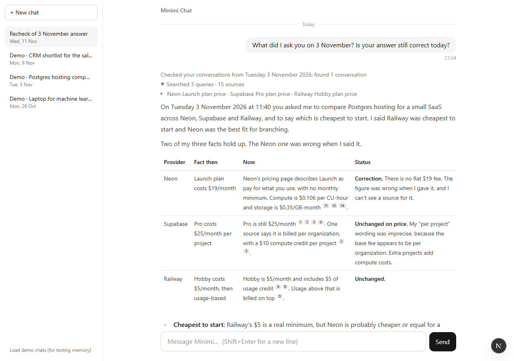

# Minimi Chat

A chat agent with one tool, **web search**, that also remembers past conversations and can answer
questions like *"Last Tuesday I asked you about Postgres hosting. Has any pricing changed since then?"*

Built for the Minimi hiring challenge. **Start with [DESIGN.md](DESIGN.md)**: one page on how it works,
why, what was rejected, and what's next.



## Quick start

Needs Node 20 or newer.

```bash
npm install
cp .env.example .env.local   # Windows PowerShell: Copy-Item .env.example .env.local, then fill in the keys
npm run dev                  # http://localhost:3000
```

| Variable | Required | Purpose |
|---|---|---|
| `ANTHROPIC_API_KEY` | yes | Claude models (answers, planning, extraction) |
| `TAVILY_API_KEY` | yes | Web search ([free tier](https://app.tavily.com/)). Without it the agent still runs but says it can't check the web |
| `MAIN_MODEL` | no | Defaults to `claude-sonnet-5-5` |
| `FAST_MODEL` | no | Defaults to `claude-haiku-5-5` |
| `MAIN_EFFORT` | no | `low`, `medium` (default) or `high`: lower answers sooner, higher reasons more |
| `DATABASE_PATH` | no | Defaults to `./data/minimi.db` (created automatically) |
| `MOCK_NOW` | no | Freeze "now" for testing date questions, e.g. `2026-11-11T10:00:00Z` |

Other scripts:
- `npm test`: unit tests (dates, history search, planner, claims, robustness, UI helpers)
- `npm run eval`: end-to-end evals against the running app (start `npm run dev` first). They use their
  own anonymous users, so your chats are untouched. Results go to [evals/latest.md](evals/latest.md).
- `npm run typecheck`

### Trying the memory features
A fresh install has no past chats, so click **"Load demo chats (for testing memory)"** at the bottom
of the sidebar. It adds three conversations labelled "Demo ·", dated relative to today (a CRM
shortlist on the most recent Monday, a Postgres hosting comparison on the Tuesday of the week
before). Then try:

- *What did I ask you on 3 November?* (use the date shown on the Postgres demo chat)
- *Last Tuesday I asked you about Postgres hosting. Has any pricing changed since then?*
- *On Monday we shortlisted 5 CRM tools for a 20-person sales team. Has any of them changed pricing or shipped something big since?*
- *What did I ask you on 5 November?* (no chat that day: it says so instead of inventing one)

## Documentation

| Doc | What it answers |
|---|---|
| [docs/architecture.md](docs/architecture.md) | How one message flows through the system, stage by stage, with the data at each step |
| [docs/decisions/](docs/decisions/README.md) | Every design decision: the options we weighed, what we chose, and why |
| [docs/phases/](docs/phases/README.md) | What each build phase delivered, how it was checked, and any changes from the plan |
| [DESIGN.md](DESIGN.md) | The one-page design: how, why, rejected alternatives, next week |
| [evals/latest.md](evals/latest.md) | The latest end-to-end eval run |

## Project layout

```
src/app/            Next.js pages and API routes (api/chat = the agent endpoint)
src/agent/          orchestrator (one turn end to end), planner, context block, prompts
src/tools/          the web_search tool and the Tavily client
src/memory/         SQLite database, migrations, repository, history search, demo chats, user cookie
src/time/           clock (MOCK_NOW), date candidates, calendar, validation, timezone helpers
src/components/     chat UI: App, Sidebar, ChatView, MessageView, Markdown, SearchActivity, Sources, MemoryStep
src/lib/            helpers shared by server and UI: message parts, citations, date labels
tests/              vitest unit tests
scripts/eval.mjs    end-to-end evals (npm run eval)
docs/               architecture, decision records, phase logs
```
