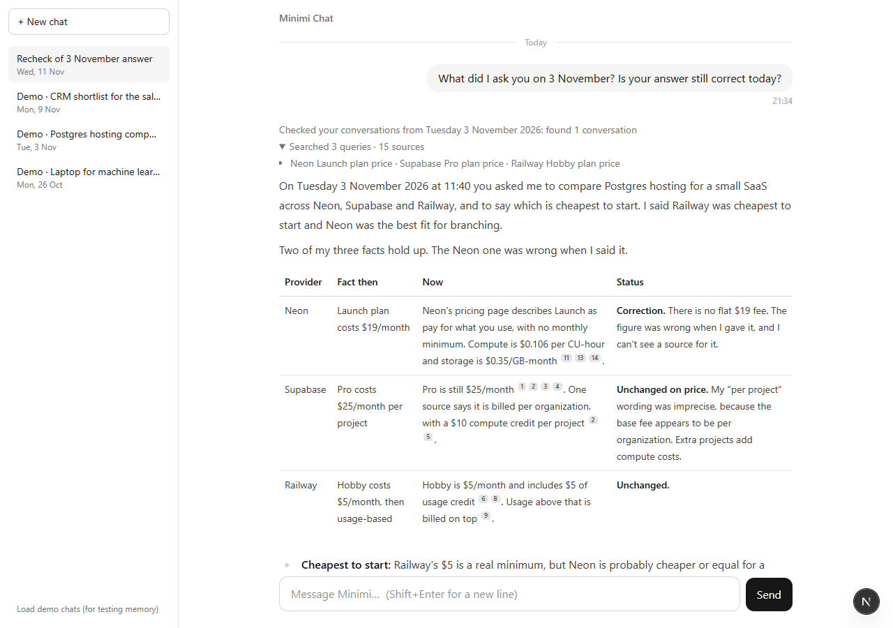

# Phase 5: UI polish

**Goal:** make answers pleasant to read and easy to trust: formatted text, clickable citations,
a tidy sources display, visible times. Design: [ADR-0014](../decisions/0014-chat-ui.md).

## What was built

| File | What it does |
|---|---|
| [src/components/Markdown.tsx](../../src/components/Markdown.tsx) | Markdown (GFM tables) with raw HTML skipped; `[n]` → citation chip with title/site/date tooltip; sideways-scrolling tables |
| [src/components/MessageView.tsx](../../src/components/MessageView.tsx) | One message: memory status, search line, formatted answer, cited sources, time, Copy (once finished), Stopped |
| [src/components/SearchActivity.tsx](../../src/components/SearchActivity.tsx) | One line for all searches: "Searching: …" → "Searched 5 queries · 18 sources" (expandable) |
| [src/components/Sources.tsx](../../src/components/Sources.tsx) | Only the cited sources, numbered to match the chips |
| [src/components/ChatView.tsx](../../src/components/ChatView.tsx) | Date dividers, multi-line input (Enter / Shift+Enter, IME-safe), auto-scroll only at the bottom, example questions |
| [src/lib/parts.ts](../../src/lib/parts.ts) | Reads sources and searches from message parts. Shared with the server ([src/agent/history.ts](../../src/agent/history.ts) now uses it) |
| [src/lib/citations.ts](../../src/lib/citations.ts), [src/lib/dates.ts](../../src/lib/dates.ts) | Citation linking; "Today / Yesterday / Tuesday 3 November 2026", local times |
| [src/agent/orchestrator.ts](../../src/agent/orchestrator.ts) | Stamps each answer's start time into the stream |
| [src/app/icon.svg](../../src/app/icon.svg), [next.config.ts](../../next.config.ts) | App icon (fixes a favicon 404); dev badge off |
| [tests/ui.test.ts](../../tests/ui.test.ts) | 9 tests: citation linking (adjacent, real links untouched), cited numbers, reading parts, date dividers by local day, local times |

## How it was checked
- `npm run typecheck`: clean. `npm test`: 103/103. `next build`: succeeds.
- **In a real browser** (Edge driven by `playwright-core`, Asia/Kolkata timezone):
  - empty screen with example questions; "Load demo chats" fills the sidebar with dated chats;
  - reopening a demo chat;
  - a live re-check typed into the input: "Checked your conversations from Tuesday 3 November 2026: found 1",
    "Searched 3 queries · 15 sources", a Then/Now/Status table with citation chips, a matching Sources list;
  - dark mode;
  - a 390 px phone: no horizontal overflow, the sidebar opens from "☰ Chats".

## Issues found by looking, and fixed
- The **Copy** button appeared while the answer was still streaming. It now appears when the answer is finished.
- The **Next.js dev badge** covered "Load demo chats" (desktop) and **Send** (phone). Turned off.
- A **missing favicon** caused a 404 on every page load. An icon was added.
- (A React hydration warning in the browser log turned out to come from the screenshot tool injecting
  a style before hydration, not from the app. A plain page load is clean.)
